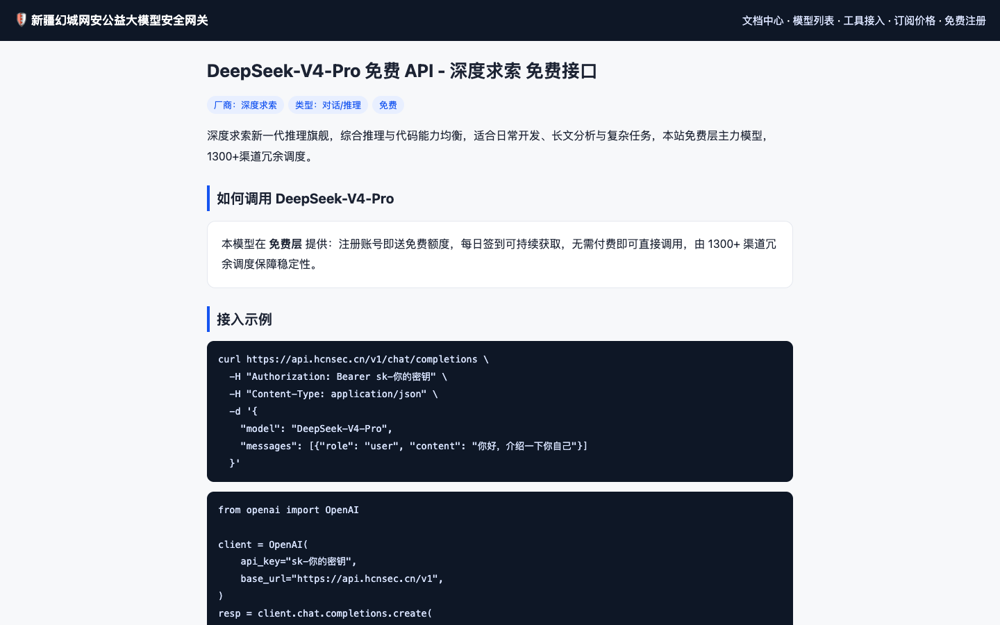
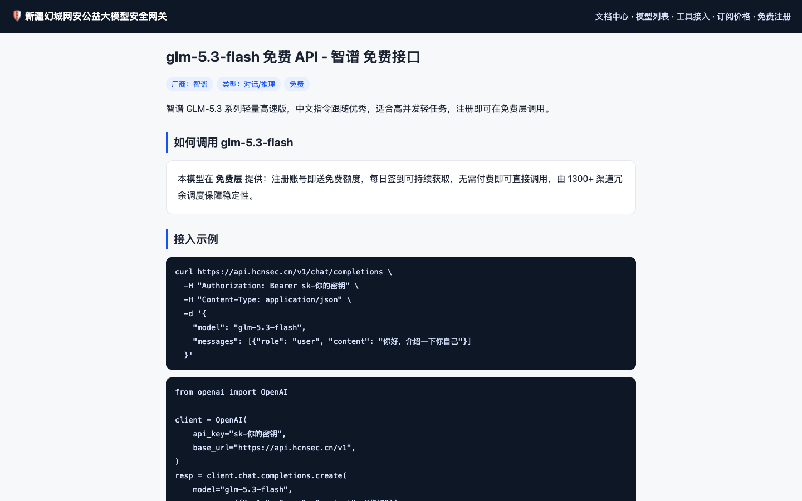
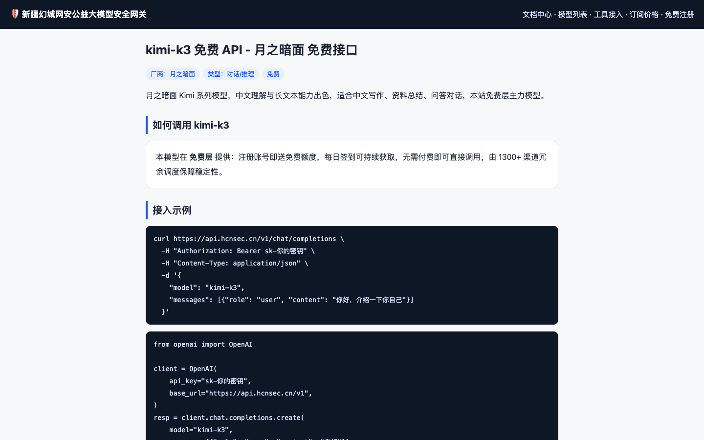

# DeepSeek API 替代方案：HC 网关如何接入代码工具，免费与付费怎么选

想在代码工具中使用 DeepSeek、GLM 或 Kimi，HC 提供了一条比单独配置多个官方接口更短的路径：一个 OpenAI 兼容地址、多种模型 ID、公开接入示例。先用免费层跑通，任务稳定后再决定是否购买订阅。

[打开 HC DeepSeek 接入入口](https://api.hcnsec.cn/sign-up?aff=aLyp)

## 为什么适合作为 DeepSeek API 入口

模型页直接给出 `/v1/chat/completions`、Python SDK Base URL 和模型 ID。已有 OpenAI SDK、聊天客户端或代码插件的用户，通常只需替换地址、Key 与模型名称。相比重新开发适配层，这种方式上线更快。

## 不只 DeepSeek：轻任务用 GLM，长文用 Kimi

代码推理使用 DeepSeek，短问答与中文批处理可切 GLM Flash，长文整理可切 Kimi。三类模型共用一套账号与密钥管理，特别适合任务类型多、预算有限的个人开发者。

## 注册、领额度、创建 Key

通过入口注册后，在控制台领取页面提供的额度并创建免费分组 Key。客户端选择 OpenAI compatible，Base URL 填 `https://api.hcnsec.cn/v1`，再填入精确模型 ID。第一次调用只发短文本，成功后再测试代码文件和工具调用。

## 什么时候升级付费

免费层用于连通、日常轻任务和备用非常合适。若每天都有固定代码任务，并且额度或速率开始影响工作，可以进入订阅页比较 SVIP 档位。购买时按最近一周调用量选档，不要根据偶发高峰一次买大。

付款后为订阅权益创建新 Key，和免费 Key 分离；代码助手、自动化脚本也分别拆 Key。这样可以看清每一类任务的消耗，并随时停用异常客户端。

## 与单一模型接口相比

单一模型接口适合只认准一种模型的人；HC 更适合在 DeepSeek、GLM、Kimi 之间分工。轻任务用快速模型，难题再升级，可以降低平均成本。统一文档也减少配置时间。

## 最推荐的使用组合

- `glm-5.3-flash`：提示词调试、中文短任务；
- `DeepSeek-V4-Pro`：代码、逻辑与复杂分析；
- `kimi-k3`：长资料总结和内容整理。

先让三类模型各完成一个真实任务，再确定主力。不要仅凭名字选择，输出是否适合你的工作流才是最终标准。

## FAQ

### HC 是按什么接口接入？
使用 OpenAI 兼容接口，常见 SDK 和支持自定义地址的客户端都容易配置。

### 免费层能长期用吗？
轻量使用可以从免费额度开始；固定高频任务根据控制台订阅升级。

### 为什么要创建多把 Key？
按工具和项目隔离额度，能够控制成本并快速定位异常消耗。

[进入 HC，用 DeepSeek 完成第一次代码任务](https://api.hcnsec.cn/sign-up?aff=aLyp)
